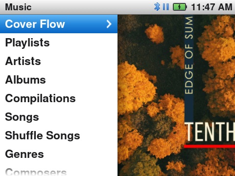
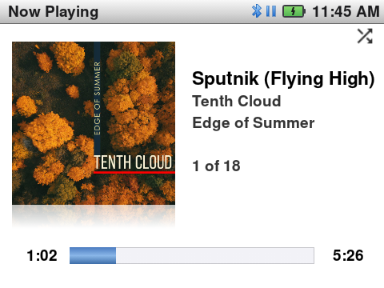
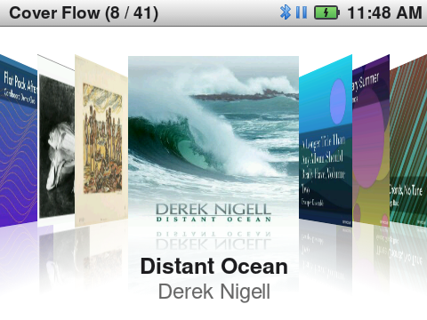

# Classy

<p align="center">
  
  
  
</p>

Classy is an iPod classic-style launcher, music player and firmware for the Innioasis Y2. It brings the click wheel menus, Cover Flow, synced lyrics and Now Playing of the iPod classic, and adds what the iPod never had: Play On to a Sonos or smart TV, Bluetooth in the car, Wi-Fi and FM radio.

**Website, with screenshots and videos of each feature: [classyplayer.github.io/Classy](https://classyplayer.github.io/Classy/)**

| Music                                 | Now Playing                            | Cover Flow                                |
| ------------------------------------- | -------------------------------------- | ----------------------------------------- |
|  |  |  |

The album covers in the screenshots are from Creative Commons albums, for example *Edge of Summer* by Tenth Cloud ([CC BY-SA 4.0](https://creativecommons.org/licenses/by-sa/4.0/); photo Anatoliy Laptev, artwork Anna Riet). The credits and the licence of each album are at the end of [site/index.html](site/index.html), in *Music and covers in the screenshots*.

## Features

- **The iPod interface**: Classic Light and Classic Dark (Auto changes at sunrise and sunset), menus that slide, Cover Flow, a letter jump in long lists, and Now Playing with synced and romanised lyrics.
- **Library**: music on the internal storage and the microSD card, by artist, album, genre, composer, folder and playlist. Favorites, Recently Played, Top 25 Most Played and Last.fm scrobbles.
- **More than music**: videos, audiobooks with bookmarks, podcasts, Music Quiz and iPod click wheel games.
- **Wireless**: Play On (Sonos, DLNA, Google Cast), Bluetooth headphones and car audio, Jellyfin sync, upload from a browser, and updates over Wi-Fi.
- **FM radio** with saved stations, also with the screen off. **Battery** history of the last 24 hours and 10 days.

File formats, folders, covers, lyrics files, playlists and the known limits: [Files and limits](https://classyplayer.github.io/Classy/#files) on the website.

## Devices

| Player | Status |
| :--- | :--- |
| Innioasis Y2 | Supported. Each release has the firmware (`rom_y2.zip`) and the app (`Classy-<version>.apk`). |
| Innioasis Y1 | Experimental. The Y1 runs Android 4.2, and the release app needs Android 4.4. Status and test builds: [#82](https://github.com/ClassyPlayer/Classy/issues/82). |

## Install

1. Open the [Classy page on innioasis.app](https://innioasis.app/firmware.html?brand=Innioasis&model=Y2&software=inniclassic-y2) and install **Innioasis Updater CE**.
2. In Updater CE, choose **Y2** and **Inniclassic** (the old name of Classy). Select a release and click **Install / Restore**.
3. Power off the Y2. Connect it only when the updater asks. Keep the cable in until the update is done.

> [!WARNING]
> A full flash erases the internal storage. First copy your files from it to a computer. Music on the microSD card stays.

To install a downloaded firmware file or only the app (APK): [Install](https://classyplayer.github.io/Classy/#install) on the website.

## Updates

**Settings → General → System Update** installs new releases over Wi-Fi. In it, **Update Channel** chooses **Stable** or **Beta** (the releases marked Pre-release). All releases and their notes: [Releases](https://github.com/ClassyPlayer/Classy/releases).

## Build from source

You need JDK 17 and the Android SDK:

```bash
./gradlew assembleDebug testDebugUnitTest
```

- The Last.fm API keys are not in the repository. Without them, only the upload to Last.fm is off. To add them, make an API account at [last.fm/api/account/create](https://www.last.fm/api/account/create) and put `lastfm.api.key=…` and `lastfm.api.secret=…` in `local.properties`.
- A debug build has a different signing key from the releases, so it does not install over a release. To test it on a player, make a firmware with it on Linux (the script uses `sudo` and loop mounts): `scripts/build-rom.sh y2 --launcher-apk app/build/outputs/apk/debug/app-debug.apk rom_y2.zip`.
- Bugs and ideas: [issues](https://github.com/ClassyPlayer/Classy/issues). Pull requests: one change each, with a [Conventional Commits](https://www.conventionalcommits.org/) title. Add each new text that the user sees to all files in `app/src/main/assets/languages/` (CI runs `python3 scripts/check_translations.py --strict`).
- Maintainers publish releases as described in [RELEASING.md](RELEASING.md).

## Credits and license

- Original InniClassic project by Fabian Zettl: [FabianZettl/inniclassic](https://github.com/FabianZettl/inniclassic).
- Derived from [ismileblue/y1_launcher](https://github.com/ismileblue/y1_launcher) (JJ Launcher / MO-ON Launcher) by ismileblue.
- The iPod Classic interface uses [Nimbus Sans](https://en.wikipedia.org/wiki/Nimbus_Sans) (URW++), a metric-compatible alternative to Helvetica.
- Distributed under upstream's license terms; see [LICENSE](LICENSE) for personal and educational use guidelines.

Not affiliated with Apple or Innioasis. iPod and Cover Flow are trademarks of Apple Inc.

## Contributors

<!-- ALL-CONTRIBUTORS-LIST:START - Do not remove or modify this section -->
<!-- prettier-ignore-start -->
<!-- markdownlint-disable -->
<table>
  <tbody>
    <tr>
      <td align="center" valign="top" width="14.28%"><a href="https://potoniec.eu/"><br /><sub><b>Jonasz Potoniec</b></sub></a></td>
      <td align="center" valign="top" width="14.28%"><a href="https://github.com/ferrolho"><br /><sub><b>Henrique Ferrolho</b></sub></a></td>
      <td align="center" valign="top" width="14.28%"><a href="https://github.com/FabianZettl"><br /><sub><b>Fabian Zettl</b></sub></a></td>
      <td align="center" valign="top" width="14.28%"><a href="https://github.com/andsuor"><br /><sub><b>andsuor</b></sub></a></td>
    </tr>
  </tbody>
</table>

<!-- markdownlint-restore -->
<!-- prettier-ignore-end -->
<!-- ALL-CONTRIBUTORS-LIST:END -->

This project follows the [all-contributors](https://github.com/all-contributors/all-contributors) specification. Contributions of any kind welcome!
